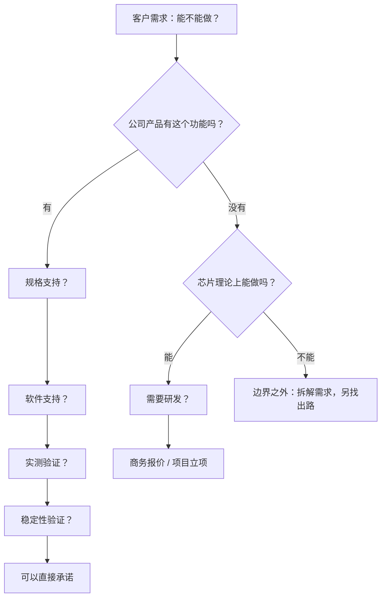

# 第 4 章 做事（上）：把"能做"变成"客户要的"

> **本章要回答的问题**：从客户问出"能不能"，到它真的跑得住，中间要走完哪几段路？

*状态：初稿（2026-10-20，由原第 9、10、11、12 章合并）｜ 写法：提出问题 → 回答问题 ｜ 待核对事项见文末「写作备注」。*

---

## 4.1 第一课：产品边界

### 一个关于"32 路"的下午

前一阵子，在一次技术交流会上，客户的工程师问我：

**"你们这个 9075，支持 32 路 1080p30 解码吗？"**

说实话，那一瞬间，我的第一反应是"支持"。因为产品规格书上写得清清楚楚：芯片支持 32 路 1080p30 解码。白纸黑字，参数漂亮。

但话到嘴边，我停了一下。我说：

**"我先做一轮测试，给你一个准确的答复。"**

当天晚上，测试结果出来了：**24、25 路稳定；到 26 路，开始出现异常和重启。**

我盯着屏幕看了很久。

不是因为结果有多意外——端侧设备跑不满规格，几乎是家常便饭。我发愣，是因为另一个问题：

**如果白天我顺口说出那句"支持"，会发生什么？**

客户的方案会按 32 路设计，报价会按 32 路核算，投标文件里会白纸黑字写上"32 路"。然后，等到验收那天，机器在客户现场一遍遍重启。到那时候，没有人会翻出规格书说"这是芯片厂写的"。他们只会记得一件事：

**那个 FAE 说过"支持"。**

为什么这件小事，值得占据这一节的篇幅？因为 FAE 这份工作，是靠"承诺"吃饭的。你说对的十句话，客户未必记得；说错的那一句，他会记很久。

而守住承诺的第一步，不是口才，也不是技术——是清楚自己的边界。**FAE 的专业，首先体现在"我知道我不知道什么"。**

那天晚上，我给自己出的，就是这一章要回答的问题：

**客户问「能不能」，我到底该怎么回答？**

这个问题不好一口气答，因为它背后是一串更小的问题：

1. 为什么规格书写着"支持"，我们实测却跑不满？
2. 怎么把一个产品的真正边界摸清楚？
3. 怎么判断一个需求属于哪一级？
4. 回答客户的时候，怎么说才稳妥？
5. 有没有一张图，能让我在客户现场快速判断？

下面，一个问题一个问题来答。

### 为什么规格书写着"支持"，我们实测却跑不满？

因为从「芯片」到「客户现场」，能力要穿过六道关——每过一关，都会被打一次折扣。

还是拿 32 路来说：

- 芯片规格写着：支持 32 路 1080p30 解码；
- 但这**不等于**：我们的盒子能稳定跑 32 路；
- 更**不等于**：客户的"32 路视频 + AI 推理 + 编码 + 显示 + 网络"完整场景，能同时跑。

这六道关是：

1. **芯片理论能力**——芯片设计上支持；
2. **BSP / 驱动能力**——驱动要能把这个能力正确地暴露出来；
3. **SDK / GStreamer 能力**——软件链路要能把它真正用起来；
4. **板卡实际能力**——内存、带宽、供电、接口；盒子不是裸芯片，盒子有盒子的脾气；
5. **整机稳定能力**——散热、长时间运行、异常恢复；
6. **客户完整业务场景能力**——把客户真实业务里的所有负载叠在一起。

一条能力从芯片出发，往下走六层，每一层都可能被截住一部分。而你，站在最后一层的门口。

客户问你"够不够用"，你不能只看山顶上标着的那个数字。

这一节只要记住一句话就够了：**规格书是在实验室里写的；客户的场景，是在现场一天天长出来的。**这两者之间的距离，就是 FAE 的工作。

### 怎么把一个产品的真正边界摸清楚？

办法很简单，但也需要耐心：**别用记忆回答，用一张表回答。**

每接手一个产品，先花时间把它的「能力边界表」填一遍——能填的、填不了的，都写下来。之后客户问问题，不从脑子里找答案，往表里套：

| 维度 | 需要明确什么 |
| --- | --- |
| 硬件 | CPU / GPU / NPU / VPU / 内存 / 存储 / 接口 |
| 编解码 | 支持什么格式、分辨率、帧率、并发 |
| AI | 支持哪些模型、框架、精度、算力 |
| 软件 | OS、BSP、SDK、驱动、GStreamer |
| 性能 | 官方规格 vs 实测数据 |
| 稳定性 | 连续运行多久、什么负载 |
| 交付 | 公司是否有现成方案 / 代码 / 技术支持 |
| 定制 | 哪些能改、哪些需要研发 |
| 商务 | 是否涉及额外报价 / 项目立项 |

前六行是技术边界；最后三行——**交付、定制、商务**——是很多技术出身的 FAE 容易忽略的边界。"技术上能做"和"我们现在卖不卖这个"，是两回事。

那么，这张表的内容从哪儿来？通常是一条有分工的路径：

1. **先学公司现成的。** 芯片的能力边界、产品的实测数据，公司通常已有现成资料——第一步，就是把它找出来、学透。
2. **缺的，推动补齐。** 如果查不到，或者资料不全、过时，就去和这个产品的产品经理沟通，把缺的验证项排进测试计划，一项一项测出来。
3. **测完的，沉淀给部门。** 结果别只留在一个人手里——整理成资料，提供给 FAE 部门学习了解。一个人的验证，要变成整个部门的边界。
4. **FAE 自己也要能动手。** FAE 本身也具备一定的设备验证能力：常规项（比如解码路数、稳定性跑测）可以先自己做一轮初验，有疑点再升级给研发。

我给自己定过一条规矩：没有验证过的能力，表里永远标"待验证"，绝不标"支持"。

这张表不是一次填完的。每做一轮测试、每遇到一个问题，它就长一点。填表的过程，就是你把这个产品真正"摸"一遍的过程。

### 四级判级：从"支持"到"另找出路"

填表的时候，你会遇到四种情况。我把它们分成四级。

**A 级：已经产品化。**

那种你"闭着眼都敢答"的能力。对客户干脆地说：**"支持。"**

**B 级：理论支持，但没有完整验证。**

比如 8K HEVC：芯片规格支持 8K HEVC；V4L2 能识别 HEVC；`/dev/video32` 也能设置 7680×4320——看起来每一步都对。

但真跑到 GStreamer 那一层，8K 60fps 解码直接报 `not-negotiated`。

这就是典型的 B 级：**理论能力 ≠ 已验证产品能力。**

这种情况不能直接说"支持 8K 60fps"，而应该说：

**"底层硬件和驱动具备对应能力，具体的软件链路和稳定性，我们还在验证。"**

【待补：这个 8K 的问题后来解决了吗？如果有结局——比如"后来定位到是 XX，某个版本之后可以稳定解码"——补在这里，B 级案例会完整很多。】

**C 级：可以做，但需要研发支持。**

比如客户说："我要在 X1 上集成一个 ModelFarm 里没有的模型。"

你心里知道：ONNX 可以转，QNN 可以跑，Aidlite 也有接口。但"有路"不等于"马上能交付"，中间还隔着：

**模型转换 → 算子适配 → QNN 编译 → 性能调优 → SDK 集成 → Demo → 测试**

这时正确的判断是：**技术上可能可行，但属于项目支持 / 研发工作，不属于标准产品能力。**

对客户，可以这么说：

**"这个需求技术上存在可能性，但超出了标准产品的范围，需要走研发评估和商务流程。"**

然后，进入那套你迟早会熟悉的流程：**需求确认 → 研发评估 → 商务报价。**

**D 级：产品边界之外。**

比如客户提出："你们这个 9075，能不能直接做完整的汽车大模型座舱？"

芯片有 NPU，"能跑模型"——但离"能做一个座舱"差了十万八千里。完整的汽车座舱，涉及 SoC、操作系统、多媒体、AI、LLM/VLM、语音、Agent、车控、ECU、中间件、HMI、车规认证、整车适配……

这时候正确的动作，不是回答"行"或"不行"，而是：

**拆解需求 → 找出公司能提供的部分 → 找出第三方或客户需要负责的部分 → 判断要不要商务和研发介入。**

把四级放在一起看：

| 级别 | 判断依据 | 对客户怎么说 |
| --- | --- | --- |
| A | 已产品化、已验证 | "支持。" |
| B | 理论支持、验证中 | "底层具备能力，软件链路 / 稳定性正在验证。" |
| C | 需要研发投入 | "技术上有可能性，属于项目支持，需要走评估流程。" |
| D | 超出产品边界 | "这超出了单方产品能力，我们先把需求拆开看。" |

### 回答客户的时候，怎么说才稳妥？

答法只有一个：**给每一句"支持"，标上它的"证据等级"。**

同样一句"支持"，背后的证据可能完全不同。把回答拆成下面六个词，客户立刻就知道，你的话"值多少钱"：

- **「规格支持」**：来源是芯片 / 产品 Datasheet。代表：理论规格。
- **「软件支持」**：来源是 SDK / BSP / 驱动 / API / 官方 Demo。代表：软件栈里已经有这个能力。
- **「已验证」**：来源是自己测试过。代表：在**明确的测试条件下**成立。比如：1920×1080 / H.265 / 25fps / 单路 / fakesink。
- **「稳定支持」**：来源是长时间、目标负载、目标环境下的测试。比如：32 路 × 1080p30 × 8 小时。这才比较接近客户真正关心的那句话——**"能不能拿去做产品。"**
- **「项目支持」**：技术上存在可能性，但需要研发投入。
- **「定制开发」**：已经明显超出标准产品能力。

注意"已验证"和"稳定支持"的区别：一个是"在某个明确条件下我测过"，一个是"扛住了接近真实场景的长时间考验"。客户真正买单的，永远是后者。

我还要专门说下"已验证"里的限定词——分辨率、格式、帧率、路数、时长。

很多人测试完，习惯说"我测过，没问题"；而客户听到的是"你们产品没问题"。**把测试条件一并说出来，是专业，不是心虚。限定词越准确，客户反而越安心**——因为那说明，你真的测过。

最后一个小技巧：当客户追问"到底行不行"的时候，不要被逼着给一个脆弱的结论。我的回答是三段式：

**把已知的说满 + 把未知的说清 + 给一个确定的下一步。**

比如："规格和软件这层我们确认支持；稳定性还在验证，我不想给你一个我自己都不确定的答案。周五之前，我把实测数据发给你。"

（至于怎么把"不行"说得体面——那是 5.2 的事，后面细聊。）

### 有没有一张图，能让我在客户现场快速判断？

有。

把前面所有的东西画成一张图，这就是我在客户现场"脑子里跑的流程"：

图很简单，但它是我见过最省心的"话术生成器"。面对每一个"能不能"，先在图上跑一遍：

- **有** → 按顺序过四道验证：规格、软件、实测、稳定性；全过了，才配说"支持"；
- **没有** → 往下问：芯片理论上能不能做？需不需要研发？要不要走商务？

跑熟之后，你回答客户的速度不会变慢，但每句话的分量，会变得不一样。

### 回到最初的问题

客户问「能不能」，我该怎么回答？

读到这里，你应该发现了：这个问题没有一句标准答案。它其实是一套四步习惯：

- **先查表**——能力边界表，不靠记忆；
- **再判级**——A / B / C / D，知道自己站在哪一级；
- **带证据说话**——六个词，把"支持"的分量说清楚；
- **永远给一个下一步**——确定的行动，比模糊的承诺更让人安心。

而这四步背后，是一种感觉，老 FAE 通常叫它"边界感"。它不是什么玄学，就是一句话：

**边界不是用来把客户挡在外面的墙，而是用来丈量承诺的尺。**

回到那个 32 路的下午。

第二天，我给了客户这样的答复：

**"芯片规格支持 32 路。但在当前产品的软件、散热和系统配置下，我们实测稳定在 24、25 路；到 26 路，开始出现异常和重启。数据我整理给你——我们一起看看，怎么靠近你的目标。"**

这句话里没有"惊喜"，甚至听起来有点"扫兴"。但从那一天起，我们和客户的对话，是建立在一张真实的桌子上的。

那个项目后来怎么走，取决于很多因素。但有一件事我很确定：

**把边界说清楚，不会失去客户。失去的，只会是那些建立在错觉上的期待——而错觉上的期待，迟早都要还的。**

如果你只从这里带走一句话，我希望是这句：

**不要把你能查到的东西，当成你能承诺的东西。**

芯片支持，不等于板卡支持；板卡支持，不等于产品支持；产品支持，不等于项目交付。

在你说出"支持"两个字之前，先让这句话，走完那六层的路。

## 4.2 接需求：听懂客户真正要什么

### 客户说："我要一个钻头"

有个很出名的说法：**人们不想买 1/4 英寸的钻头，他们想要一个 1/4 英寸的洞。**

这句话，做 FAE 的人应该贴在脑门上。

因为客户来找你的时候，说的是钻头；他真正想要的，是洞；而洞的背后，往往还有一个"为什么"——他想把一幅画挂在墙上。

如果你只听见"钻头"，你的方案就会围绕钻头做：推荐更硬的钻头、更快的转速、更长的保修。

但如果他真正的问题是"墙太硬，洞打不进去"，或者"他其实想挂的是一面镜子，需要更大的洞"，你的钻头再好，也解决不了他的问题。

【待补：这里补一个你"差点会错意"的真实案例——客户提了什么需求？你（或同事）是怎么理解的？后来发现他真正想要的是什么？结局如何？】

### 客户的话，要过三层翻译

客户说的，客户要的，客户真正需要的——这是三件不同的事。

- **第一层，客户说的（钻头）**：一个具体的功能、参数、型号。"我要 32 路"、"我要 XX 功能"、"我要那个最新款"。
- **第二层，客户要的（洞）**：他要解决的问题。"我要把这 32 路视频接进来，做质检"。
- **第三层，客户真正需要的（挂画）**：他要达成的业务目标。"产线要减少质检人力，良率要提上去"。

越往下，越接近真相；越往下，客户自己越说不清楚。

因为第一层是他"想好了的"，第二层是他"知道的"，第三层是他"感觉到的"。

FAE 的价值，就是从第一层，问出第三层。

### 五个问题，问出真正要什么

那怎么问？

我常用的，是五个问题。

**第一个问题：这东西从哪来、到哪去？**

问场景：视频从哪来？接到哪去？结果给谁看？

把输入、处理、输出问清楚，需求就有了骨架。

**第二个问题：你们现在是怎么做的？**

现有方案，是最好的参照系。

客户现在的做法里，藏着痛点：哪里慢、哪里贵、哪里总出错。这些，才是他要解决的。

**第三个问题：为什么是这个数字？**

"为什么是 32 路，不是 16 路？"

数字背后，通常有约束：预算、工艺、上级要求、客户合同。搞清楚了约束，你才知道这个数字能不能谈。

**第四个问题：然后呢？**

"跑出结果之后，谁来处理？"

这一问，是从"洞"挖到"挂画"——挖到业务闭环。很多需求，问到"然后呢"，真实目标就浮出来了。

**第五个问题：项目做成了，你怎么判断它成功？**

把验收标准前置。

如果客户说不清"成功长什么样"，这个项目大概率会有麻烦——因为到验收的时候，每个人心里的标准都不一样。

### 客户的四类需求：痛点、爽点、痒点、盲点

问出来的需求，性质也不一样。有个很好用的分类：

- **痛点**：没有它，客户受不了。这是基础功能，必须解决；
- **爽点**：有了它，客户会惊喜。这是亮点功能，能做则做；
- **痒点**：可有可无，条件允许时最好有；
- **盲点**：客户自己不知道需要，你一说他才恍然大悟。

前两类，决定方案能不能成立；后两类，决定方案能不能出彩。

尤其是"盲点"——它代表客户的认知边界。你能指出他没意识到的问题，你在这次沟通里的分量，就不一样了。

### 说话的是"一个人"，不是"一个需求"

还有一个容易被忽略的事：

坐在你对面的客户，不是"一份需求的载体"，是一个具体的人。

他提的这个需求，可能不只是为了项目——也可能是为了他自己：

- 增强他在部门里的影响力；
- 制约某个竞争对手（公司内或公司外）；
- 这是他领导的想法，他要落实；
- 或者，这个项目只是为了花掉一笔预算。

这些动机，不会写在需求文档里。

但如果你听不懂，方案就可能"在技术上全对，在人的层面全错"。

所以，接需求的时候，除了问"你要什么"，还要想一层：**他为什么要？**

（当然，这一层只能观察和体会，不能问出口。）

### 最后：听懂之后，还要说回去

需求听懂了，还有最后一步：**说回去。**

用你的话，把需求复述一遍，让客户确认：

- 你要解决的是不是这个？
- 验收的标准是不是这个？
- 哪些在范围内，哪些不在？

最好落在书面上：会议纪要、邮件、需求确认单。口头确认，等于没确认。

POC 验证，还要"带回客户的需求"。需求带回公司之后，还要过一遍流程：确认交付物和交付条件 → 研发评估工作量 → 商务报价。

如果这一步漏了，前面听得再准，也白搭。

所以这一节的最后一句是：

**听懂，不是说"我明白了"，是让对方说"对，就是这个"。**

## 4.3 出方案：把"能做"变成"客户要的"

### 方案不是从模板开始的

接到"出个方案"的任务，很多人的第一反应是找模板：上次那个项目的方案还在，改改名字、换换型号，半天就能交。

快是快。但这样交出去的，通常不是方案——是产品说明书的搬家。

我给方案只留一个定义：**方案，是对需求的一次完整回答。**

4.2 说过，需求有三层：客户说的（钻头）、客户要的（洞）、客户真正需要的（挂画）。方案就是把这三层，一层一层答回去：

- 你要的钻头，我们有——这是**产品**；
- 你要打的那个洞，这么打——这是**系统**；
- 你真正想挂的那幅画，挂上之后怎么保证不掉——这是**业务与风险**。

所以方案的第一页，不应该是公司介绍，不应该是产品参数，而应该是这一句：

**我理解你要解决的问题，是这个。**

客户看到这一页，如果点头——"对，就是这个"——后面的内容他才会认真看。如果他翻开第一页看到的是一段千篇一律的公司简介，他心里的判断是：这是一份可以群发的材料。

而可以群发的材料，是不会被认真对待的。

【待补：一个你能拿得出手的方案全过程——什么客户、什么需求、你是怎么理解需求的、方案怎么设计的、客户怎么反馈的、最后成了没有。这一段是本章的"现场感"，缺了它，后面都是道理。】

### 一份方案要回答三个问题

一份方案，不管多厚，本质上只在回答三个问题。

**第一个：用什么？**

产品、型号、配置、数量。这是客户最容易看懂的一层，也是很多方案唯一写了的一层。

**第二个：怎么搭？**

数据从哪来，经过什么，到哪去；软硬件怎么配合；接口怎么接；客户现有的系统怎么对接。这一层决定了方案能不能落地——产品是好的，搭不起来，一样是废纸。

**第三个：为什么值？**

这套东西放进去，客户的哪个指标会变好？是省了人力，还是提了良率，还是让他的系统终于能上线？这一层最难写，因为它不能用参数回答，只能用客户自己的语言回答。

三个问题，对应三种读者：**技术看第二个，老板看第三个，采购看第一个。**

一份好方案，是让这三种人都能找到自己要的那一页。

### 选型：为什么我不选"最强的那一个"

方案里最考验判断的，是选型。

新手容易犯两个方向的错：一个是"哪个便宜选哪个"，另一个是"哪个最强选哪个"。

两个都不对。选型的目标不是"最好"，是**够用，并且有余量**。

为什么必须有余量？因为 4.1 那条教训：**规格 ≠ 能力。**

规格书上写支持 32 路，实测 24、25 路稳定。如果方案按 32 路设计，这个项目从签字那天起就埋了一颗雷。所以方案里的数字，要按"稳定值"写，不能按"规格值"写。

余量，就是承认"实验室和现场不是一回事"的那部分空间。

但余量也不是越多越好。客户要 10 路，你给一个能跑 60 路的配置，方案是安全了，报价也把客户吓跑了。过大的余量，是把风险变成了浪费。

所以选型的手艺，说到底是在"不够"和"浪费"之间找那条线。

除了性能和成本，还有几样东西要一起看：

- **软件生态**：芯片再好，工具链不全、算子不支持，模型迁不过去，等于零；
- **供货周期**：方案写得再漂亮，货期八个月，客户的窗口期早就过了；
- **生命周期**：客户买的不只是一块板子，是未来三到五年的供货、维护和升级。

这些，规格书上都不写。但它们在验收的时候，一个都不会少。

### 方案里最值钱的部分，是"边界"

很多方案有一个通病：通篇都是"能"。

能解码、能接入、能部署、能扩展……一页一页翻下去，没有一句"不能"。

这样的方案，客户反而不敢信。

因为客户不傻。他知道没有任何一个产品什么都能干，一份全是"能"的方案，只说明两件事：要么你没认真看我的需求，要么你不敢说真话。

所以我在方案里，坚持把能力分成三种状态写：

- **已验证能**：我们自己的设备上跑过、有数据、有证据；
- **规格支持**：芯片或软件规格上支持，但我们没在完整场景里验证过——有条件；
- **待验证**：目前不确定，需要 POC 或者研发评估。

这三种状态，对应的就是 4.1 那套证据等级。方案里每一个"支持"，后面都应该能接上一个等级。

那"待验证"的部分怎么办？三条路，选一条：

1. **换**：方案层面回避掉，用一条已验证的路径绕过去；
2. **验**：写进 POC，用事实验证——这是 4.4 的内容；
3. **认**：承认需要定制开发或者项目支持，走研发评估工作量、商务报价的流程。

最不能选的，是第四条路：先写上"能"，出了问题再说。

因为方案不是给客户看的宣传品，是**承诺的第一次落笔**。你今天在方案里写下的每一个"支持"，将来都可能变成验收桌上的一句话：

**"你们方案里写了。"**

写"不能"不是免责，是让客户在做决定的时候，手里的信息是完整的。

### Demo：演示给谁看？

方案讲到一定程度，客户会说："能不能演示一下？"

Demo 很重要。但很多 Demo 做错了方向——做成了才艺表演：把最炫的功能、最漂亮的画面、最顺利的流程演一遍，台下鼓掌，皆大欢喜。

然后客户拿真实数据一试，翻车了。

Demo 翻车的伤害，比不演示大得多。因为不演示只是"还没证明"，翻车是"已经证伪"。

所以 Demo 的设计原则只有一条：

**演示客户最担心的那个点，而不是你最容易演示的那个点。**

- 客户担心稳定性？那就连续跑几个小时，当着面跑；
- 客户担心精度？那就把误差、漏检、误检率摆出来，别只放成功案例；
- 客户担心集成？那就现场接他的相机、他的数据、他的网络环境。

演示的目的是消除疑虑，不是制造惊叹。惊叹会过去，疑虑不会。

如果客观条件不允许现场演示——设备没到、环境不具备——那就用视频、测试报告、已有客户的案例。证据可以换形式，但不能没有。

### 一份方案的骨架

说到这里，可以给一个能直接用的骨架了。一份方案，七段：

| 段落 | 要回答的问题 |
| --- | --- |
| 1. 需求理解 | 你要解决的是不是这个？（4.2 的"说回去"） |
| 2. 方案总览 | 一张图能不能看懂数据从哪来、到哪去？ |
| 3. 选型与配置 | 为什么是这几个型号？（够用、余量、成本） |
| 4. 能力边界与风险 | 能做什么、不能做什么、什么待验证？ |
| 5. 验证路径 | POC 怎么验、怎么算通过？（4.4） |
| 6. 交付与服务 | 谁实施、怎么交付、售后怎么算？（2.2 的交付链） |
| 7. 范围与商务 | 报价包含什么、不包含什么、超出范围怎么算？ |

七段里，第 1 段和第 4 段最容易被省掉，也最不该省。

第 1 段省了，方案就没有根，客户觉得你在自说自话；第 4 段省了，方案就没有底，客户觉得你在赌。

还要提醒一句：**骨架可以复用，内容不能群发。**

模板解决的是"别漏东西"，不是"替你想问题"。七段骨架交到手里，每一段里的判断，还是得你自己做。

### 方案是写给三种人看的

前面说过，一份方案有三类读者。这件事值得单独说，因为很多人写方案时，脑子里只有一个读者——那个跟自己对接的工程师。

但方案是要往上走的。

- **工程师**看的是：架构对不对、参数够不够、接口通不通；
- **他的老板**看的是：这件事能不能成、风险在哪里、花这个钱值不值；
- **采购**看的是：报价包含什么、范围怎么定、以后加东西怎么算。

三类人，三种语言。

所以一份成熟的方案，通常是这样组织的：**正文讲人话，附录放细节。**

正文用业务语言说清楚"解决什么问题、怎么解决、有什么风险"；参数表、接口定义、测试数据，全部放进附录，让工程师自己去翻。

最怕的是两种极端：正文全是参数，老板看不懂，方案死在第一轮；或者通篇业务愿景，一个技术细节都没有，工程师一看就觉得你不专业。

### 最后：方案的目的，是帮客户做决定

写到这里，可以回答本节开头那个问题了。

客户要的，我们做得到吗？——这个问题，方案必须诚实地回答。做得到就说做得到，有条件就说有条件，做不到就说做不到，不确定就说"我们验证一下"。

因为方案的目的，从来不是"证明我们很强"。

**方案的目的，是帮客户做决定。**

一份好方案，客户看完应该知道三件事：这件事能不能成、大概要花多少钱、最坏的情况是什么。

这三件事清楚了，他才敢拍板。

客户做决定时，最怕的从来不是"你做不到"——做不到他可以找别人。他最怕的是"你不知道自己做不到"。

所以，这一节的最后一句是：

**能做，是技术；把能做说清楚，是方案；让客户敢拍板，才是 FAE。**

## 4.4 做验证：从"理论支持"到"稳定支持"

### 那天晚上之后，故事还没完

4.1 讲过那个晚上：客户问 9075 能不能跑 32 路 1080p30，我没有顺口说"支持"，而是回去测了一轮。结果是——24、25 路稳定，26 路开始异常、重启。

很多人听到这里，觉得故事已经讲完了：哦，FAE 要严谨，不能乱承诺。

但故事其实才到一半。

因为客户第二天还会问："那到底能跑多少路？"

而"24、25 路"这五个字，不是测一次就能说出口的。它得先回答一串问题：

- 是在什么分辨率、什么格式、什么帧率下测的？
- 只解码，还是同时带 AI 推理、编码、显示？
- 跑了多久？十分钟没崩，能算稳定吗？
- 26 路挂掉，是花屏、丢帧，还是整机重启？症状不一样，结论就不一样。
- 换个散热条件、换个码流，这个数字会不会变？

你看，同一个晚上，同一个设备，同一组数字。说不清楚这些，它就是"一次观察"；说清楚了，它才是"一个结论"。

而 FAE 交到客户手里的，必须是结论。

所以这一节要回答的问题是：

**一句"支持"，怎么变成一句敢负责的"稳定支持"？**

4.3 说过，方案里的能力分三种状态：已验证能、规格支持、待验证。这一节讲的，就是把"待验证"这一格，一格一格填掉的过程。

### 验证不是"跑一下看看"，是设计一个能推翻自己的实验

新手做验证，通常是这样的：把设备接上，跑一下，没崩，截图，交差。

这不叫验证，这叫"看了一眼"。

真正的验证，在开测之前就要定好三样东西：

**第一，变量：你要测的是什么？**

是并发路数？是某个模型能不能跑？是 8K 能不能解？还是一条链路的端到端延迟？

一次只测一个。**同时改三个东西，挂了都不知道是谁挂的。**

**第二，条件：在什么条件下测？**

硬件型号、软件版本、配置参数、码流来源、环境温度、运行时长。这些条件不是背景，是结论的一部分。

4.1 说过：限定词越准确，客户反而越安心。因为那说明你真的测过。

**第三，判据：什么算通过？**

这一条最容易被跳过，也最要命。

"跑起来了"不算判据。"连续 8 小时不重启、不丢帧、延迟稳定在 X 毫秒以内"才是判据。

判据必须**在开测之前**写下来。

为什么？因为人是有立场的。测完之后再定标准，你总会不自觉地往"看起来还行"那边靠。

先写判据，再开测试机。这是验证的第一条纪律。

### 怎么找到那条边界线？

验证最核心的动作，是找边界。

客户问"能跑 32 路吗"，其实他真正想知道的是："最多能稳定跑多少路？"

这两个问题的答案，往往不是一个数字，而是一条线、甚至一张表。

**找线的方法，是递增压力。**

从低往高加：8 路、16 路、24 路、28 路、32 路。找到第一个失败点，再在失败点附近细化——24、25、26，一路一路试。

32 路那个案例，边界就是这么找出来的：24、25 路稳定，26 路异常。**断点，就是边界。**

找断点的时候，还要记下"症状"，因为症状会说话：

- 花屏、丢帧 → 多半是解码或带宽的问题；
- 延迟越跑越大 → 多半是队列堆积、处理不过来；
- 整机重启 → 可能是内存耗尽、温度保护、看门狗。

同一个"挂"，症状不同，后面要查的方向完全不同。

【待补：26 路异常后来定位到什么原因？内存带宽？散热？驱动？还是系统配置？如果有结论，补在这里——它能解释"为什么边界正好画在 26"，这一节就从方法变成了故事。】

还有一件很多人忽略的事：**边界不是一条线，是一张表。**

同一个盒子：

- 1080p30，能到 24、25 路；
- 1080p60，可能只有一半；
- 再加 AI 推理，又不同；
- 换成 H.264 或 H.265，也不同。

所以"能跑多少路"这个问题，正确的回答永远是："在什么条件下，能到多少。"

一句话说不清的边界，才是真实的边界。

### 长时间稳定性，到底在测什么？

短测能测出"跑不跑得动"，测不出"跑不跑得住"。

跑得住，是另一回事。它要面对的是那些**慢慢发生**的问题：

- **内存泄漏**：跑一小时看不出，跑八小时，内存曲线一路向上，最后 OOM；
- **句柄 / 资源泄漏**：文件描述符、线程、DMA 缓冲，一点点漏，漏到某个点突然崩；
- **温度**：刚开机是凉的，跑两小时到了热平衡，降频、丢帧、甚至重启才出现；
- **日志写满**：磁盘被日志塞满，写不进去，业务跟着挂——这种问题，只有跑得够久才遇得到；
- **偶发问题**：网络抖动、码流异常、上游断开。跑十次挂一次。

最后这条要单独说：**跑十次挂一次，就是不通过。**

在实验室里，"偶发"是百分之十；在客户现场，设备跑一年，"偶发"就是必然。

所以长跑测试的判据，不能只看"有没有崩"，还要看曲线：

- CPU、内存、温度，是不是平稳；
- 延迟有没有随时间漂移；
- 日志里有没有反复出现的错误；
- 崩溃之后，设备能不能自己恢复。

我一般会把长跑放在过夜：下班前开跑，第二天早上看结果。跑之前，把版本号、配置、温度、时间记下来——不然第二天看到异常，你连"当时是什么状态"都说不清。

### POC：不是演示，是验证一个假设

说到这里，就绕不开 POC。

POC 这两个词很容易被理解成"给客户演示一下"。不是。

POC 的本质是：**用客户的数据、客户的场景，验证一个关键假设。**

注意三个词：客户的数据、客户的场景、一个假设。

- **客户的数据**：用自己的测试视频，永远比客户的干净。POC 要用他的码流、他的模型、他的异常样本；
- **客户的场景**：能去现场就去现场。去不了，也要尽量复刻——同型号设备、同版本软件、同网络条件；
- **一个假设**：一次 POC 只回答一个问题。想一次验证五个点，最后五个点都验证不干净。

POC 开始之前，必须和客户确认四件事：

| 要确认的 | 具体问什么 |
| --- | --- |
| 验证什么 | 这次 POC，我们到底要证明哪一个假设？ |
| 判据是什么 | 达到什么程度，算通过？ |
| 交付物是什么 | 结束时给什么？测试报告、演示环境、还是数据？ |
| 时间盒与退出条件 | 做多久？什么情况下提前结束？ |

这四件事不落地，POC 大概率会变成一场没有终点的陪跑：客户觉得"还差点意思"，你觉得"已经尽力了"，双方都说不出问题在哪。

因为**没有判据的验证，结论只能靠感觉；靠感觉的结论，谁都可以不认。**

POC 结束，还有一步：把需求带回来。

这是流程问题，也是很多技术出身的 FAE 容易漏的一环：POC 验证出来的新需求、新条件，要整理清楚——交付物是什么、交付条件是什么——带回公司，交研发评估工作量，再走商务报价。

POC 的意义，从来不只是"证明行"，也包括"提前证明不行"。

在 POC 阶段发现不行，代价是一次测试；在验收阶段发现不行，代价是一个项目。

### POC 最容易踩的三个坑

**第一个坑：没有判据。**

前面说过了。补一句：没有判据的 POC，还会无限延长。因为"感觉不行"不是一个可以结束的状态。

**第二个坑：现场随手改，环境漂移。**

客户现场一急，改个配置、换个库、临时打个补丁——问题"解决"了，但你不知道是哪一刀解决的，也不知道这一刀会不会砍出别的问题。

现场可以改，但必须做三件事：记录改了什么、改前改后的版本是什么、结果有什么变化。

不记录的改动，等于把证据毁掉。

**第三个坑：范围蔓延。**

POC 做着做着，客户说"顺便把这个也加进来"、"那个也试试"。

一个 POC 只验证一个假设。新需求记下来，客气地放回流程里：确认需求 → 评估 → 排期。这不是推脱，是让每一件事都有据可依。

### 一份测试报告，该长什么样？

验证的产出，不是"我测过了"这句话，是一份能被别人使用的报告。

我习惯按这个顺序写：

1. **结论先行**：通过 / 不通过 / 有条件通过。客户和老板只看这一行；
2. **测试对象与环境**：设备型号、软件版本、关键配置；
3. **方法与数据**：怎么测的、用什么码流/模型、跑了多久；
4. **结果与数据**：曲线、日志片段、失败记录；
5. **边界结论**：在什么条件下，能到什么程度；
6. **风险与建议**：还有哪些没验证、建议怎么处理。

这里面最容易被省掉的，是第 4 条的"失败记录"。

有些人不愿意写失败：只放成功的那次，只截好看的那张图。但**只写成功的报告，等于没测。**

因为读者要拿这份报告做决定。你藏起来的那个失败，将来会在客户现场替他做决定。

一份报告的可信度，取决于一条证据链：

**版本 + 配置 + 数据 + 日志 + 结果。**

五样齐了，别人能照着复现，你的结论才站得住；缺一样，它就只是一个说法。

### 最后：验证的终点，不是"通过"

验证做完了，还有两件收尾的事。

**第一，回填。** 把结果填回 4.1 那张能力边界表：原来标"待验证"的，改成"已验证"或"稳定支持"；原来标"支持"的，如果测出来不行，改回来。

一个人的验证，要变成整个部门的边界。否则下一个同事，还要再踩一遍你踩过的坑。

**第二，分拣。** 验证中暴露的问题，有的自己能修，有的要报给研发——怎么把现象整理成研发能处理的问题，是 5.1 的事。

最后，回到本节开头那个问题：

一句"支持"，怎么变成一句敢负责的"稳定支持"？

答案是：**用条件把它框住，用时间把它熬住，用数据把它撑住。**

规格是别人写的，稳定是你测出来的。

所以 4.1 那个下午的结论，其实还有下半句：

**客户买的不是"我们测过"，是"我们测过你们的场景"。**

---

**本章速记（一页纸）**

- **一条链**：芯片理论 → BSP / 驱动 → SDK / GStreamer → 板卡实际 → 整机稳定 → 客户场景
- **一张表**：能力边界表（别忘了最后三行：交付 / 定制 / 商务）
- **四级**：A 直接承诺 / B 说"验证中" / C 走项目流程 / D 拆解需求
- **六个词**：规格支持、软件支持、已验证、稳定支持、项目支持、定制开发
- **三层需求**：说的（钻头）→ 要的（洞）→ 真正需要的（挂画）
- **五问**：从哪来到哪去 / 现在怎么做 / 为什么是这个数字 / 然后呢 / 怎么算成功
- **方案七段**：需求理解 / 方案总览 / 选型配置 / 边界风险 / 验证路径 / 交付服务 / 范围商务
- **验证三要素**：变量 / 条件 / 判据（判据先写，再开机）
- **两条金句**：不要把你能查到的东西，当成你能承诺的东西；客户买的不是"我们测过"，是"我们测过你们的场景"

---

**写作备注（不入正文）**

- 本章为初稿，由原第 9、10、11、12 章合并而成；4.1 来自原第 9 章（v3），4.2 来自原第 10 章，4.3 来自原第 11 章，4.4 来自原第 12 章。
- 【待补】8K `not-negotiated` 的后续结局（4.1 的 B 级案例）；26 路异常后来的定位（4.1 或 4.4）。
- 【待补】"差点会错意"的需求案例（4.2）；"一个拿得出手的方案全过程"（4.3）；完整的 POC 案例（4.4）。
- 【待核对】4.1 的场景（交流会上被问、当晚实测）为叙事化重建，如与事实有出入，以真实情况为准来改。
- 【待核对】4.2 的四类需求与个人动机清单来自 `素材/07`；4.3 的七段骨架、选型维度是否符合公司实际；4.4 的 POC 四确认、报告六段是否符合公司流程。
- 【待定】产品与平台名称（9075 / X1 / ModelFarm / Aidlite 等）是否脱敏——全书统一决定。
- 【来源】`素材/02`（六层链、边界表、A/B/C/D、证据等级、32 路实测）、`素材/07`（需求分类、个人需求、需求确认）、`素材/05`（POC 带回需求、确认交付物与交付条件 → 研发评估 → 商务报价）、`素材/10`（硬件选型、软件适配、POC 需求评估）。
- 【请反馈】四节合起来约两万字，是全书的"重心"；如果觉得太重，可以考虑把 4.4 单独拆成一章（回到 5 章 + 1 章的方案）。

