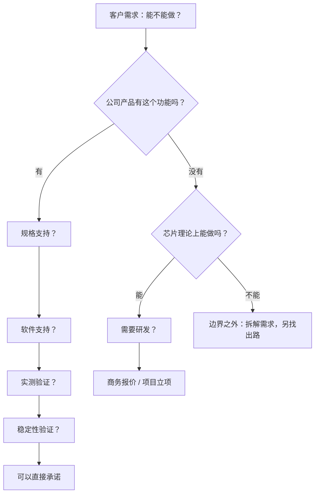

# 第 9 章 第一课：产品边界

*状态：试写样章 · v1（故事体，2026-10-16）。已被后续版本取代，此版仅作对比保留。*

---

> **芯片支持 ≠ 板卡支持 ≠ SDK 支持 ≠ Demo 支持 ≠ 产品支持 ≠ 项目交付。**

---

## 9.1 一个关于"32 路"的下午

前一阵子，在一次技术交流会上，客户的工程师问我：

**"你们这个 9075，支持 32 路 1080p30 解码吗？"**

说实话，那一瞬间，我的第一反应是"支持"。因为产品规格书上写得清清楚楚：芯片支持 32 路 1080p30 解码。白纸黑字，参数漂亮。

但话到嘴边，我停了一下。我说：

**"我先做一轮测试，给你一个准确的答复。"**

当天晚上，测试结果出来了：**24、25 路稳定；到 26 路，开始出现异常和重启。**

我盯着屏幕看了很久。

不是因为结果有多意外——端侧设备跑不满规格，几乎是家常便饭。我发愣，是因为另一个问题：

**如果白天我顺口说出那句"支持"，会发生什么？**

客户的方案会按 32 路设计，报价会按 32 路核算，投标文件里会白纸黑字写上"32 路"。

然后，等到验收那天，机器在客户现场一遍遍重启。到那时候，没有人会翻出规格书说"这是芯片厂写的"。他们只会记得一件事：

**那个 FAE 说过"支持"。**

这一章想讲的，就是"支持"这两个字背后，需要走完的路。

## 9.2 为什么"边界"是第一课

在这本书的第三部分，我把"产品边界"放在了所有方法的最前面。原因很简单：

**FAE 这份工作，是靠"承诺"吃饭的。**

你的技术再好，方案再漂亮，都建立在一个前提上——客户相信你说的话。而信任这个东西，建立起来很慢，消耗起来却很快。你说对的十句话，客户未必记得；你说错的那一句，他会记很久。

很多新人以为，FAE 的专业感体现在"我什么都知道"。其实恰恰相反——

**FAE 的专业，首先体现在"我知道我不知道什么"。**

知道边界在哪里，你才敢承诺；敢承诺，客户才敢信。边界不是用来把客户挡在外面的墙，而是用来丈量承诺的尺。

所以这一课，我们不急着谈人情世故。先谈清楚一件事：客户问"能不能"的时候，你到底该怎么回答。

## 9.3 规格 ≠ 能力 ≠ 交付：一条六层的路

先说一个几乎所有新人都会踩的坑：**把"规格支持"当成"我们能做到"。**

还是这个 32 路：

- 芯片规格写着：支持 32 路 1080p30 解码；
- 但这**不等于**：我们的盒子能稳定跑 32 路；
- 更**不等于**：客户的"32 路视频 + AI 推理 + 编码 + 显示 + 网络"完整场景，能同时跑。

从「芯片」到「客户现场」，中间至少隔着六层能力：

1. **芯片理论能力**——芯片设计上支持；
2. **BSP / 驱动能力**——驱动要能把这个能力正确地暴露出来；
3. **SDK / GStreamer 能力**——软件链路要能把它真正用起来；
4. **板卡实际能力**——内存、带宽、供电、接口；盒子不是裸芯片，盒子有盒子的脾气；
5. **整机稳定能力**——散热、长时间运行、异常恢复；
6. **客户完整业务场景能力**——把客户真实业务里的所有负载叠在一起。

一条能力从芯片出发，往下走六层，每一层都可能被截住一部分。而你，站在最后一层的门口。

客户问你"够不够用"，你不能只看山顶上标着的那个数字。

规格书是在实验室里写的；客户的场景，是在现场一天天长出来的。这两者之间的距离，就是 FAE 的工作。

## 9.4 别用记忆回答：能力边界表

那怎么办？

我的办法是：**别用记忆回答客户，用一张表回答。**

每接手一个产品，先花时间把它的「能力边界表」填一遍——能填的、填不了的，都写下来。之后客户问问题，不从脑子里找答案，往表里套：

| 维度 | 需要明确什么 |
| --- | --- |
| 硬件 | CPU / GPU / NPU / VPU / 内存 / 存储 / 接口 |
| 编解码 | 支持什么格式、分辨率、帧率、并发 |
| AI | 支持哪些模型、框架、精度、算力 |
| 软件 | OS、BSP、SDK、驱动、GStreamer |
| 性能 | 官方规格 vs 实测数据 |
| 稳定性 | 连续运行多久、什么负载 |
| 交付 | 公司是否有现成方案 / 代码 / 技术支持 |
| 定制 | 哪些能改、哪些需要研发 |
| 商务 | 是否涉及额外报价 / 项目立项 |

前六行是技术边界；最后三行——**交付、定制、商务**——是很多技术出身的 FAE 容易忽略的边界。"技术上能做"和"我们现在卖不卖这个"，是两回事。

这张表的填法，只有两条来源：**官方规格**和**你自己的实测**。我给自己定过一条规矩：没有亲自验证过的能力，表里永远标"待验证"，绝不标"支持"。

这张表不是一次填完的。每做一轮测试、每遇到一个问题，它就长一点。填表的过程，就是你把这个产品真正"摸"一遍的过程。

## 9.5 四级判级：从"支持"到"另找出路"

填表的时候，你会遇到四种情况。我把它们分成四级。

**A 级：已经产品化。**

那种你"闭着眼都敢答"的能力。对客户干脆地说：**"支持。"**

**B 级：理论支持，但没有完整验证。**

比如 8K HEVC：芯片规格支持 8K HEVC；V4L2 能识别 HEVC；`/dev/video32` 也能设置 7680×4320——看起来每一步都对。

但真跑到 GStreamer 那一层，8K 60fps 解码直接报 `not-negotiated`。

这就是典型的 B 级：**理论能力 ≠ 已验证产品能力。**

这种情况不能直接说"支持 8K 60fps"，而应该说：

**"底层硬件和驱动具备对应能力，具体的软件链路和稳定性，我们还在验证。"**

【待补：这个 8K 的问题后来解决了吗？如果有结局——比如"后来定位到是 XX，某个版本之后可以稳定解码"——补在这里，B 级案例会完整很多。】

**C 级：可以做，但需要研发支持。**

比如客户说："我要在 X1 上集成一个 ModelFarm 里没有的模型。"

你心里知道：ONNX 可以转，QNN 可以跑，Aidlite 也有接口。但"有路"不等于"马上能交付"，中间还隔着：

**模型转换 → 算子适配 → QNN 编译 → 性能调优 → SDK 集成 → Demo → 测试**

这时正确的判断是：**技术上可能可行，但属于项目支持 / 研发工作，不属于标准产品能力。**

对客户，可以这么说：

**"这个需求技术上存在可能性，但超出了标准产品的范围，需要走研发评估和商务流程。"**

然后，进入那套你迟早会熟悉的流程：**需求确认 → 研发评估 → 商务报价。**

**D 级：产品边界之外。**

比如客户提出："你们这个 9075，能不能直接做完整的汽车大模型座舱？"

芯片有 NPU，"能跑模型"——但离"能做一个座舱"差了十万八千里。完整的汽车座舱，涉及 SoC、操作系统、多媒体、AI、LLM/VLM、语音、Agent、车控、ECU、中间件、HMI、车规认证、整车适配……

这时候正确的动作，不是回答"行"或"不行"，而是：

**拆解需求 → 找出公司能提供的部分 → 找出第三方或客户需要负责的部分 → 判断要不要商务和研发介入。**

把四级放在一起看：

| 级别 | 判断依据 | 对客户怎么说 |
| --- | --- | --- |
| A | 已产品化、已验证 | "支持。" |
| B | 理论支持、验证中 | "底层具备能力，软件链路 / 稳定性正在验证。" |
| C | 需要研发投入 | "技术上有可能性，属于项目支持，需要走评估流程。" |
| D | 超出产品边界 | "这超出了单方产品能力，我们先把需求拆开看。" |

## 9.6 说话带上"证据等级"：六个词

还有一招，我认为每个 FAE 都值得练：**回答问题时，永远带上"证据等级"。**

同样一句"支持"，背后的证据可能完全不同。把回答拆成下面六个词，客户立刻就知道，你的话"值多少钱"：

- **「规格支持」**：来源是芯片 / 产品 Datasheet。代表：理论规格。
- **「软件支持」**：来源是 SDK / BSP / 驱动 / API / 官方 Demo。代表：软件栈里已经有这个能力。
- **「已验证」**：来源是自己测试过。代表：在**明确的测试条件下**成立。比如：1920×1080 / H.265 / 25fps / 单路 / fakesink。
- **「稳定支持」**：来源是长时间、目标负载、目标环境下的测试。比如：32 路 × 1080p30 × 8 小时。这才比较接近客户真正关心的那句话——**"能不能拿去做产品。"**
- **「项目支持」**：技术上存在可能性，但需要研发投入。
- **「定制开发」**：已经明显超出标准产品能力。

注意"已验证"和"稳定支持"的区别：一个是"在某个明确条件下我测过"，一个是"扛住了接近真实场景的长时间考验"。客户真正买单的，永远是后者。

我还要专门说下"已验证"里的限定词——分辨率、格式、帧率、路数、时长。

很多人测试完，习惯说"我测过，没问题"；而客户听到的是"你们产品没问题"。**把测试条件一并说出来，是专业，不是心虚。限定词越准确，客户反而越安心**——因为那说明，你真的测过。

最后一个小技巧：当客户追问"到底行不行"的时候，不要被逼着给一个脆弱的结论。我的回答是三段式：

**把已知的说满 + 把未知的说清 + 给一个确定的下一步。**

比如："规格和软件这层我们确认支持；稳定性还在验证，我不想给你一个我自己都不确定的答案。周五之前，我把实测数据发给你。"

（至于怎么把"不行"说得体面——那是"沟通与承诺"一章的事，我们后面细聊。）

## 9.7 一张图，带你在现场做判断

把前面所有东西画成一张图，这就是我在客户现场"脑子里跑的流程"：

图很简单，但它是我见过最省心的"话术生成器"。面对每一个"能不能"，先在图上跑一遍：

- **有** → 按顺序过四道验证：规格、软件、实测、稳定性；全过了，才配说"支持"；
- **没有** → 往下问：芯片理论上能不能做？需不需要研发？要不要走商务？

跑熟之后，你回答客户的速度不会变慢，但每句话的分量，会变得不一样。

## 9.8 边界不是墙，是尺

回到那个 32 路的下午。

第二天，我给了客户这样的答复：

**"芯片规格支持 32 路。但在当前产品的软件、散热和系统配置下，我们实测稳定在 24、25 路；到 26 路，开始出现异常和重启。数据我整理给你——我们一起看看，怎么靠近你的目标。"**

这句话里没有"惊喜"，甚至听起来有点"扫兴"。但从那一天起，我们和客户的对话，是建立在一张真实的桌子上的。

那个项目后来怎么走，取决于很多因素。但有一件事我很确定：

**把边界说清楚，不会失去客户。失去的，只会是那些建立在错觉上的期待——而错觉上的期待，迟早都要还的。**

如果你只从这一章带走一句话，我希望是这句：

**不要把你能查到的东西，当成你能承诺的东西。**

芯片支持，不等于板卡支持；板卡支持，不等于产品支持；产品支持，不等于项目交付。

在你说出"支持"两个字之前，先让这句话，走完那六层的路。

---

**本章速记（一页纸）**

- **一条链**：芯片理论 → BSP / 驱动 → SDK / GStreamer → 板卡实际 → 整机稳定 → 客户场景
- **一张表**：能力边界表（别忘了最后三行：交付 / 定制 / 商务）
- **四级**：A 直接承诺 / B 说"验证中" / C 走项目流程 / D 拆解需求
- **六个词**：规格支持、软件支持、已验证、稳定支持、项目支持、定制开发
- **一句话**：不要把"芯片能力"当成"公司承诺"。

---

**写作备注（不入正文）**

- 【待补】26 路异常后来的定位（散热 / 驱动 / 带宽？）——补进 9.1 或 9.8，故事会更完整。
- 【待补】8K `not-negotiated` 的后续结局（9.5 B 级案例）。
- 【待核对】9.1 的场景（交流会上被问、当晚实测）为叙事化重建，如与事实有出入，以真实情况为准来改。
- 【待定】产品与平台名称（9075 / X1 / ModelFarm / Aidlite 等）是否脱敏——全书统一决定。
- 【请反馈】"故事开头 → 方法 → 案例 → 收尾 + 速记"的结构，能否定为 What 部分的统一章法？
- 【来源】主要依据 `素材/02_产品边界意识.md`；流程口径参考 `素材/05_技术支持与项目POC验证的区别.md`。
